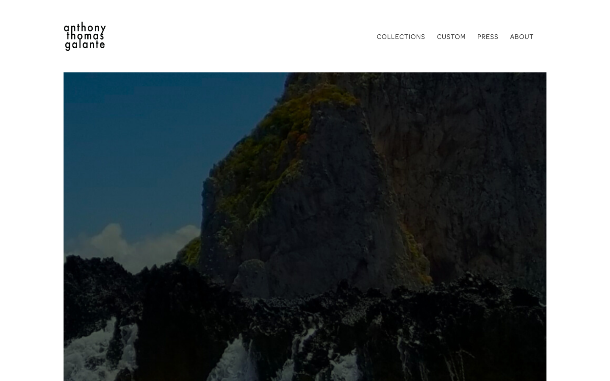

Anthony Thomas Galante is a New York fashion designer. His site was running WordPress on SiteGround, about $20 a month, 13 pages built up over years of WPBakery shortcodes and Gutenberg blocks. He wanted it off WordPress, onto something free, still looking like his brand, and editable by him without calling a developer every time he adds a lookbook. I ran the whole migration through Claude Code, myself as the only human in the loop. Here’s what that actually looked like, not the highlight reel.

## Read before you touch anything

The first move wasn’t code. I pointed two exploration agents at the problem in parallel: one auditing the live site’s rendered pages, one inventorying the WordPress backup, the theme, the plugins, the 13MB database dump. Both reported back inside about ten minutes, and the inventory changed the plan before I wrote a line of it: the homepage hero lived in Revolution Slider tables, not in page content. The fonts loaded from an Adobe Typekit kit nobody on our side had access to. WooCommerce was installed with zero products, quietly dormant. None of that was in the brief. All of it mattered before extraction could start.

## The call I overruled on day one

The extraction plan Claude proposed first was to parse the database dump directly, since that’s the technical system of record. I pushed back before it got built: the site is only 13 pages, and the rendered front end, already resolved through WPBakery and Gutenberg, was clean HTML with the shortcode soup gone. Pulling from the live mirror instead of the raw dump meant skipping an entire shortcode-conversion problem. The database stayed useful for exactly three things the front end couldn’t give: the newsletter subscriber list (which then stayed out of the repo entirely, gitignored, never deployed), the mapping from resized image derivatives back to true originals, and a cross-check that nothing the front end showed was missing from the source. One call, made in a few minutes, that saved a redundant conversion layer for the rest of the project.

## Auditing what nobody asked me to audit

Before any extracted page went into the CMS, a review pass checked all 34 caption-to-image pairings on the site against the original screenshots, not just against the database records. Zero pairings turned out to be mismatched. But the same pass caught things worth catching: a link that still pointed at a `wp-content` URL, a press link carrying a leftover tracking token in its query string, two malformed URLs, and a couple of source typos that had been live on the site for years. None of that was requested. It’s the kind of check that mostly finds nothing, and that’s fine. It’s cheap insurance against the one time it doesn’t.

That’s the migration end to end: 13 pages off WordPress, checked against the original at every step, nothing quietly dropped along the way.

## Same look, new site: design concepts, not design decisions

Nothing about the brand changed. Anthony’s site was already monochrome, full-bleed photography, restrained typography; the redesign kept that system and built the rest of the site up to it, instead of replacing it with something that happened to be easier to build. Every time a page’s design gets revisited, my rule is three genuinely different concepts, built as clickable HTML previews, before any of it touches real code. The press page concepts didn’t get built until extraction had delivered the real 25 press mentions, real publication names, real photos, so the review was against real content, not filler. Anthony liked pieces of two of the three: one concept’s photography, another’s typographic record of each mention. I sent that combination back as a new option. A couple of rounds later, the hybrid ("The Catalogue": a masonry of press plates, each with its entry printed underneath, readable without a hover) was the one that landed.

<figure>

<figcaption><a href="https://anthonythomasgalante.com/press/" target="_blank" rel="noopener">Press page</a> was redesigned to bring Anthony’s impressive designs and clients to the foreground.</figcaption>

</figure>

Same pattern on the collection pages: three structurally different hero treatments to solve one specific problem (tall 2:3 portrait photography meeting a wide desktop viewport), full crop versus full push versus something in between. Anthony picked the version that added a text column beside the photo instead of cropping it. I can generate concepts fast. Which one is right for someone else’s brand isn’t my call to make alone. The result reads like the same site, just working harder: no rebrand, no new visual language, just the version of it WordPress couldn’t build.

<figure>

<figcaption><a href="https://anthonythomasgalante.com" target="_blank" rel="noopener">anthonythomasgalante.com</a></figcaption>

</figure>

## From $20 a month to $0

The old site cost about $20 a month for plain WordPress hosting. The new one is a static Astro build that runs for free. Cloudflare hosts it, deploying straight from the repo. Keystatic Cloud handles the CMS, also free: Anthony signs in with his own email, no GitHub account, no code, and edits collections, lookbooks, and press entries directly. Every save writes a file into the same repo the site builds from, so his content isn’t locked inside a CMS vendor’s database; if he ever wants to swap the editing tool later, the files underneath are still just files. Hosting and content editing together: $0 a month, once DNS cutover clears the one blocker left, which is registrar access on his end, not the build.

## Where the time actually went

The build ran one morning: about five hours at the keyboard, 7:40am to 12:45pm, one sitting with no break longer than fifteen minutes. Roughly four of those hours were the build proper, after an hour of planning and a parallel site-audit up front. That four-hour figure already includes every second spent waiting on the model. Subtract the LLM’s own generation and agent-run time, and my hands-on share (directing, reviewing, deciding, testing between turns) was about two hours. Three production deploys landed along the way as fixes got verified live. Two shorter sittings followed later, under an hour combined: an evening pass on the session-logging tooling, then a separate day on DNS, mail records, and registrar access ahead of cutover, which turned up the real registrar, DreamHost, not the one everyone assumed. Thirteen pages migrated. I recovered 98 unique media originals out of 320 total attachments in the old library (97 found, 1 confirmed gone for good) and optimized the set 247.7MB → 26.0MB. All of it staged, reviewed, and CMS-ready before the client saw a single deploy.

## What actually got delegated

Reading and inventorying: agents, running concurrently. Mechanical extraction and format conversion: agents. First-draft design concepts: agents, on a model sized to the task rather than the biggest model available for everything. What didn’t get delegated: which design direction fits the brand, whether a caption actually matches its photo, what counts as a launch blocker versus a nice-to-have, and any call that touches someone else’s business. The checkpoints weren’t a formality layered on top of the work. They were where the actual judgment happened.

The site is built, reviewed, and staged on Cloudflare. Cutover, the DNS switch that makes it the live site, is waiting on registrar access from the client, which is a normal, boring blocker and has nothing to do with whether the build itself is done.
