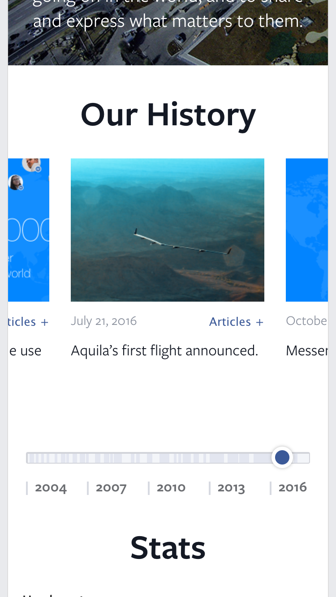

<figure>

<video src="/media/newsroom.mp4" poster="/media/newsroom-poster.jpg" controls preload="metadata" playsinline aria-label="Screen capture video of the shipped newsroom.fb.com"></video>

<figcaption>The shipped Newsroom in motion: a screen capture recorded in 2017, three years after launch, still running the theme I built in 2014.</figcaption>

</figure>

In 2014, I led the technical rebuild of Facebook’s press site, newsroom.fb.com. I was a front end developer and team lead at Beyond, an SF user experience agency, and Facebook was one of our two biggest clients at the time, alongside Google.

## The problem

This wasn’t a greenfield build. Facebook already had a Newsroom at that address, live since at least 2012, on a legacy ASP.NET publishing system with its own admin backend and page templates. It wasn’t responsive, and it didn’t fit how a global communications team actually worked: product news, executive statements, and press materials going out around the clock, in more than one language, to reporters checking from a phone as often as a desktop. A relaunch had to preserve years of press history, migrate it cleanly off that old platform, and clear WordPress VIP’s engineering bar (the enterprise WordPress platform Automattic runs for large publishers and media companies). And it had to do all that while still looking and behaving like Facebook, not a generic WordPress blog.

## The approach

I was in the room from the sales conversation onward, giving technical input during the design and user research phases before any code got written, so the design team wasn’t handed constraints after the fact. Once we started building, I led all technical aspects of the redesign and replatform: a fully custom, responsive WordPress theme built from scratch, plus the custom plugins the Newsroom needed on top of it. I built it alongside another front end engineer and a QA engineer, all of it held to WordPress VIP’s code standards. VIP runs its own code review before anything goes live on its infrastructure, so the bar wasn’t just "does it work," it was "does it pass someone else’s audit." One of the harder pieces of the build was an interactive timeline component with touch support that had to behave the same swiping on a phone as clicking on a desktop, a genuinely new interaction pattern for a corporate press site in 2014.

I also wrote the migration scripts that moved years of posts and media off Facebook’s legacy platform into WordPress without losing anything: old press releases, executive statements, images, all of it had to land in the new system intact and still findable. After launch, I led the internationalization work, taking the Newsroom into seven additional language editions (Portuguese, German, Spanish, French, Italian, Japanese, and Korean, each on its own subdomain) alongside the original English, eight languages total. The communications team needed to publish well beyond Menlo Park.

<figure>

<figcaption>The Japanese edition at ja.newsroom.fb.com, one of seven language subdomains built on the same theme. Captured in 2017; still the template I shipped in 2014.</figcaption>

</figure>

## The result

Newsroom.fb.com relaunched in mid-2014 as Facebook’s first WordPress site, and the first responsive consumer site built on WordPress VIP. It held up well enough that it turned into a longer relationship rather than a one-off engagement: Beyond went on to build Year in Review and the Internet.org site for Facebook off the back of it.

<figure>

<figcaption>The Our History timeline on a phone: swipe the cards or drag the year scrubber to move through Facebook’s history, the same interaction on a phone as on a desktop. Captured in 2017, three years after launch, still running the theme I built in 2014.</figcaption>

</figure>

## Postscript, 2026

The site had a long run. It kept publishing under its own newsroom.fb.com address, with the same basic identity and template, for roughly five years, evolving its section list along the way, before Facebook folded it into a broader corporate site, about.fb.com, in November 2019.

More than a decade on, the interesting part of this project isn’t the tech. WordPress VIP’s review process and a jQuery-era timeline widget aren’t how I’d build this today. What holds up is the constraint underneath it: shipping inside a platform you don’t control, to a bar someone else sets, without the result feeling like it was assembled by committee, and without the migration losing a single post along the way. That’s the same discipline I use now working inside a client’s existing CMS or design system instead of my own stack: read the platform’s rules first, then build inside them, rather than fighting them.
